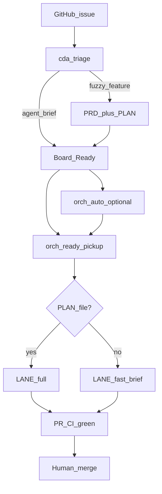

# Architecture — agent orchestration

## Components

| Piece | Role |
| ----- | ---- |
| `cda-triage` | Turns inbound issues into Ready + durable **agent brief** (or needs-info / human) |
| `orch.sh` | Kanban modes: intake, **ready-pickup**, pr-fix — worktrees, verify loop, PR, CI watch |
| `orch-auto.sh` | Opt-in poller: discover Ready → call `ready-pickup` |
| `headless.sh` | One prompt + verify in the current tree — **no** issue / worktree / PR |
| Host agent CLI | `agent` / `cursor-agent` / `claude` / `opencode` (or `ORCH_AGENT`) |

Boundary (accepted ADRs):

- **ADR-001** — Host apps stay outside the kit; headless ≠ Kanban.
- **ADR-002** — Fast-lane + orch-auto; do not teach headless `--issue` / open PR.

## Ready → PR flow

Autonomy stops at a **mergeable, CI-green PR**. No auto-merge.

## Lanes (`ready-pickup`)

| Condition | Lane | Contract |
| --------- | ---- | -------- |
| `plans/PLAN-<id>-*.md` exists | `full` | Plan (+ epic PRD when present) |
| No plan; triage comment contains `## Agent Brief` | `fast` | Agent brief only |
| No plan and no brief | — | Worker blocked |

Bugs / bounded scope may go Ready with brief alone. Fuzzy enhancements still
need PRD → plan before Ready.

## What headless is for

Local one-shot tasks (“fix this test”) with a verify loop. It does **not**
claim board cards or open PRs. Use orch / orch-auto for ticket-backed work.
